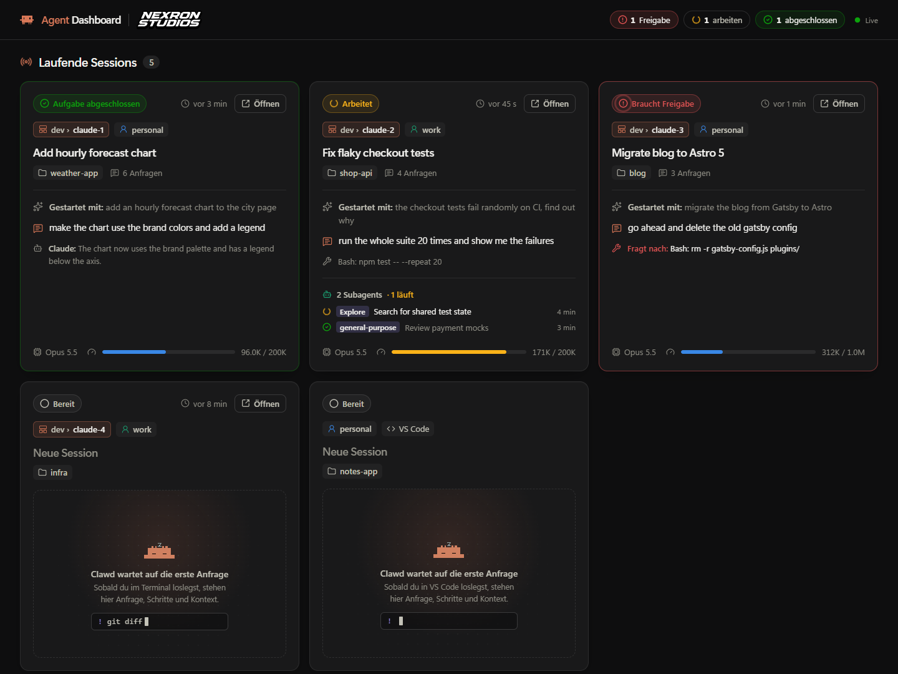
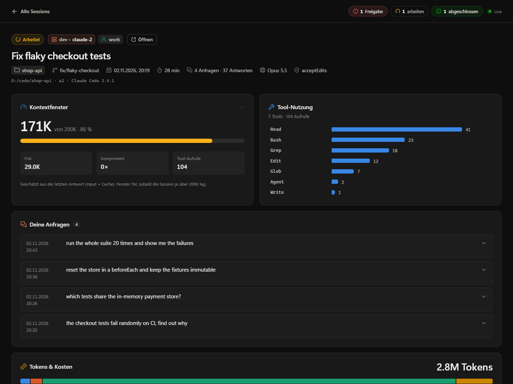
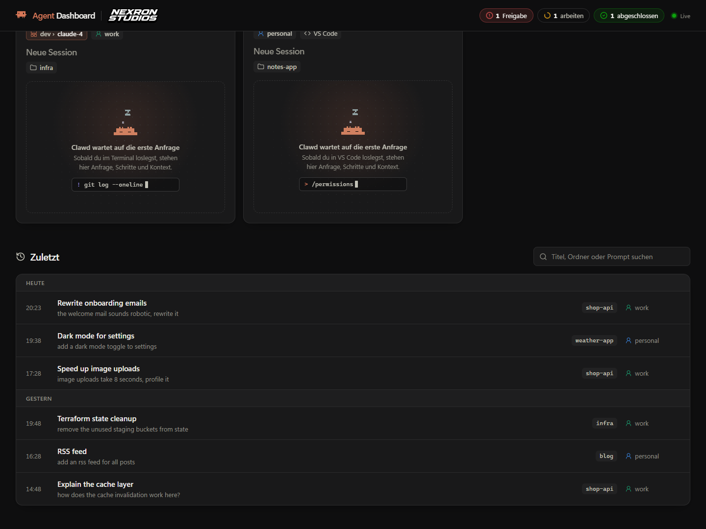

# Agent Dashboard - NEXRON

A live overview of every [Claude Code](https://claude.com/claude-code) session running on your machine. It's a desktop app (Tauri 2 + Vue 3) with a lightweight terminal version alongside it.

Run several Claude Code sessions at once and see at a glance which one is working, which one is done and which one is waiting for your approval, without clicking through terminal tabs.



> The interface is in German. The screenshots use demo data.

## Features

- **Running sessions as cards.** Every live session from every Claude profile, with its status:
  - *Braucht Freigabe* (needs your approval)
  - *Arbeitet* (working)
  - *Aufgabe abgeschlossen* (done, your turn)
  - *Bereit* (fresh session, no prompt yet)
- **What each card shows:** the first and the latest prompt, Claude's last step or reply, running subagents, the model, and how full the context window is.
- **Header counters** for approvals, working sessions and finished sessions, refreshed every 2 seconds.
- **One click into the right place.**
  - *Öffnen* brings the session's [herdr](https://herdr.dev) tab to the front.
  - Clicking the folder chip opens the session's working directory in Explorer.
- **Detail view** for every session:
  - all of your prompts in full
  - the context window
  - tool usage
  - tokens per category and model
  - cost, once Claude Code writes it to the transcript
  - subagents, errors and a timeline
- **Recent sessions** (*Zuletzt*), grouped by day and searchable by title, folder or prompt.
- **Multiple accounts.** Every Claude profile gets its own color, so you can tell work and personal sessions apart.
- **Read-only.** The app only reads Claude Code's files. It never writes to them.





## Requirements

- Windows 11 (WebView2 is preinstalled). macOS and Linux should work but are untested.
- [Node.js](https://nodejs.org) 22
- [Rust](https://rustup.rs) (stable)
- [Claude Code](https://claude.com/claude-code), used at least once so that `~/.claude` exists
- Optional: [herdr](https://herdr.dev), to map sessions to terminal tabs
- Optional: Python 3, for the terminal version

## Getting started

```powershell
git clone https://github.com/nexron-studios/agentdashboard.git
cd agentdashboard
npm install
npm run app:dev
```

`npm run app:dev` starts the desktop app in development mode with hot reload. The Vite server runs on port 1450, with hot reload on 1451. The first start compiles the Rust side and takes a few minutes. Later starts are fast.

To build an installer:

```powershell
npm run app:build    # installer ends up in src-tauri/target/release/bundle
```

For everyday use, run the built app, not the development one. `src-tauri/target/debug/agentdashboard` has no frontend of its own: it loads the page from the Vite server on port 1450, so the window goes black as soon as that server stops. On macOS, build only the app bundle and copy it to `~/Applications`:

```bash
npx tauri build --bundles app
ditto "src-tauri/target/release/bundle/macos/Agent Dashboard - NEXRON.app" "$HOME/Applications/Agent Dashboard - NEXRON.app"
```

### Terminal version

If you don't want to build the app, there's a terminal version with no dependencies:

```powershell
python tui/agentdashboard.py   # Ctrl+C to quit
```

## How to use it

1. **Start the dashboard.** Leave it open on a second screen or next to your terminal.
2. **Start Claude Code** in any terminal or in VS Code. A new card shows up within 2 seconds.
3. **Watch the status.**
   - A red card (*Braucht Freigabe*) means Claude is asking for permission, and *Fragt nach* shows what it wants to run.
   - A green card (*Aufgabe abgeschlossen*) means Claude is done and it's your turn.
4. **Jump to the session.**
   - *Öffnen* switches to its herdr tab.
   - The folder chip opens its project folder in Explorer.
5. **Click a card** for the detail view: every prompt, token usage and the timeline. Press `Esc` or *Alle Sessions* to go back.
6. **Find older sessions** in *Zuletzt* below the cards. Type in the search box to filter by title, folder or prompt.

### Multiple Claude accounts

Every folder in your home directory named `.claude` or `.claude-<name>` that contains a `projects/` folder counts as a profile. `CLAUDE_CONFIG_DIR` is picked up too. The profile name is the part after `.claude-`. The default profile is called *Standard*.

For example, `~/.claude-work` shows up as **work**.

### herdr integration

If [herdr](https://herdr.dev) is installed and its server is running, each card shows its workspace and tab (e.g. `dev › claude-2`), and running sessions are sorted in tab order. The dashboard matches sessions to tabs by process ID, using `herdr pane process-info` and Claude Code's `sessions/<pid>.json`. Without herdr, everything else works the same.

### Session titles

Claude Code names a session once, at the start, and never renames it. When you keep working in the same chat on something else, the dashboard asks Haiku for a new short title through `claude -p --model haiku` (no tools, no MCP servers, no saved transcript). No API key is needed: the call runs on the subscription of the profile the session belongs to. It only runs for live sessions whose topic changed, at most once every 2 minutes per session. Titles are stored in `%APPDATA%\com.nexron.agentdashboard	opics.json`, and the original title stays visible as „Gestartet als …“.

## How it works

- **Live sessions** come from `sessions/<pid>.json` in each profile. Dead processes are filtered out.
- **Content** comes from the transcripts in `projects/*/<session>.jsonl`. Each running transcript is read once in full, and after that only new lines are read, so polling stays cheap even for long sessions.

## Development

```powershell
npm run typecheck    # vue-tsc
npm test             # Rust tests + terminal version tests

# Benchmark the parser against a real transcript:
$env:AGENTDASHBOARD_SAMPLE = "<path>.jsonl"
cargo test --release --manifest-path src-tauri/Cargo.toml parses_real_transcript -- --ignored --nocapture
```

| Path | Contents |
| --- | --- |
| `src-tauri/src/sessions.rs` | Finds profiles, live sessions and transcripts |
| `src-tauri/src/herdr.rs` | Maps sessions to herdr workspaces and tabs |
| `src-tauri/src/topics.rs` | Short titles for the current topic via `claude -p` |
| `src-tauri/src/transcript.rs` | Incremental transcript parser |
| `src-tauri/src/lib.rs` | Tauri commands: `overview`, `session_detail`, `focus_herdr`, `open_folder` |
| `src/components/` | Overview, session card, detail view, timeline, status badge, logos |
| `tui/` | Terminal version (Python, no dependencies) |

## Disclaimer

Agent Dashboard is an independent project by NEXRON Studios. It is not affiliated with or endorsed by Anthropic. Claude, Claude Code and Clawd are trademarks of Anthropic.
